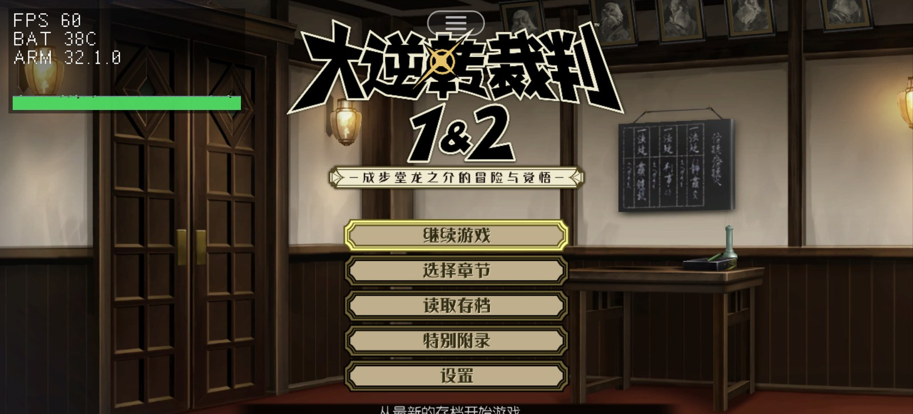
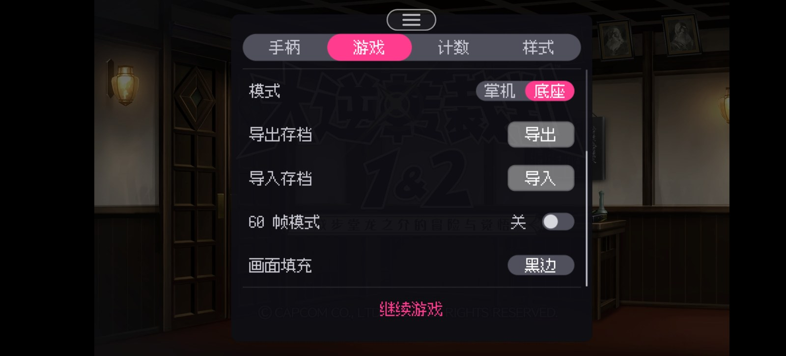
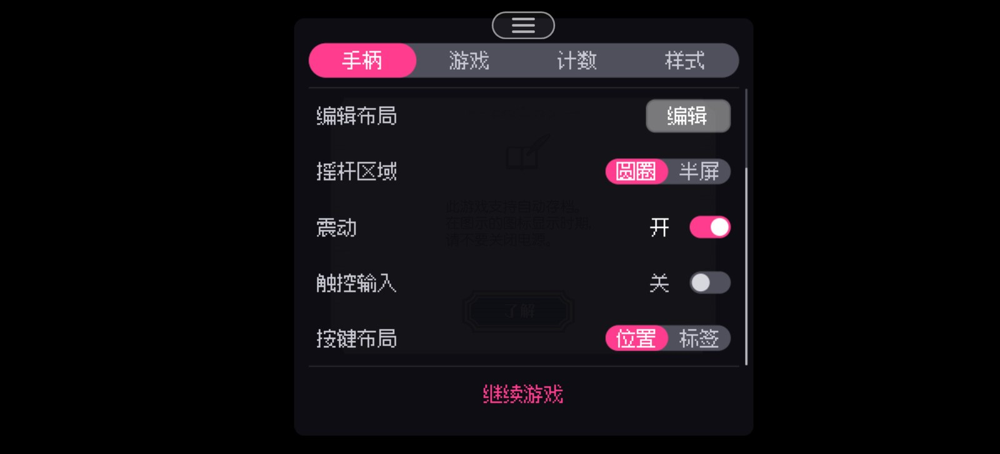
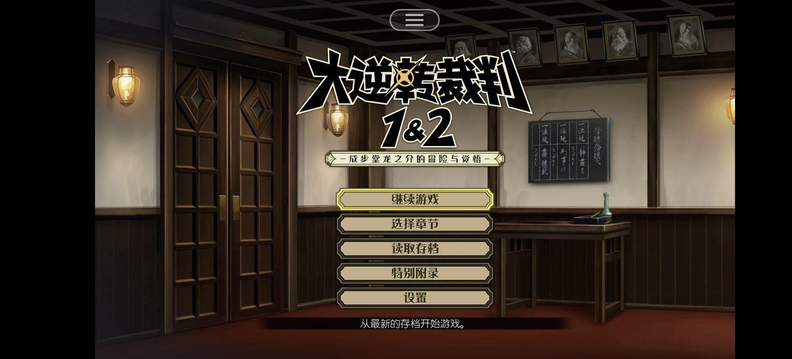

<div align="center">

# The Great Ace Attorney Chronicles 1&2 — Android 原生移植

**Switch 版《大逆转裁判 1&2》的 Android 原生重编译移植（非模拟器 · Vulkan 渲染）**

*Native Android recompilation port of The Great Ace Attorney Chronicles (Switch), powered by [nx2Android](https://github.com/shirai91/nx2android).*

[](../../releases/tag/v1.4.0)
[](#环境要求与兼容性)
[-black?logo=github)](https://github.com/shirai91/nx2android)
[](https://github.com/qzj112223/TGAAC-Android/issues)

[快速开始](#快速开始) · [环境要求](#环境要求与兼容性) · [性能实测](#性能实测60-帧) · [自己生成数据包](#自己生成数据包本仓库不提供) · [常见问题](#常见问题) · [更新日志](CHANGELOG.md)

</div>

> **⚠️ 重要声明：本仓库只包含构建好的 APK 和脚本，不包含任何游戏数据、密钥或反编译产物。**
> 使用前请先阅读文末的 [免责声明 / Disclaimer](#免责声明--disclaimer)。

> 🎉 **致谢上游 [nx2Android](https://github.com/shirai91/nx2android)** —— 本移植完全由其开源的 `porter` 工具链（MIT）生成：将 Switch 的 ARM64 代码静态重编译为原生程序，并提供 Horizon 系统服务与 Maxwell GPU 的 Vulkan 兼容层，让「自己 dump、自己生成、自己玩」成为可能。

> **最新版 [v1.4.0](../../releases/tag/v1.4.0)**：新增「**画面填充**」—— 暂停菜单「游戏」页签可在线切换 **黑边 / 铺满 / 拉伸** 三档，铺满与拉伸会一并延伸进屏幕刘海区，2.2:1 一类宽屏手机上的两侧黑边就此消失（默认仍是黑边）；同时把「触控输入」放回「手柄」页签。详见 [CHANGELOG.md](CHANGELOG.md)。

---

## 目录

- [核心特性](#核心特性)
- [实机截图](#实机截图)
- [快速开始](#快速开始)
- [环境要求与兼容性](#环境要求与兼容性)
- [性能实测（60 帧）](#性能实测60-帧)
- [操作与覆盖菜单](#操作与覆盖菜单)
- [自己生成数据包（本仓库不提供）](#自己生成数据包本仓库不提供)
  - [第一部分：自己动手做](#第一部分自己动手做)
  - [第二部分：交给 Agent 做（提示词）](#第二部分交给-agent-做提示词)
- [常见问题](#常见问题)
- [技术细节](#技术细节)
- [免责声明 / Disclaimer](#免责声明--disclaimer)
- [致谢与许可证](#致谢与许可证)

---

## 核心特性

- **原生重编译，非模拟器**：游戏 ARM64 逻辑转译为 C 并编译为 Android `arm64-v8a` 原生代码，图形走 Vulkan。
- **在线 60 帧模式（1:1 速度）**：暂停菜单「游戏」页一键切换 30↔60 fps，无需重启；仅抬高渲染上限 `sApp.mMaxFps`，逻辑基准 `mFps` 保持 30，打字、自动播放、转场与镜头速度完全 1:1。
- **画面填充 / 全面屏适配**：暂停菜单「游戏」页签的「画面填充」提供三档 —— **黑边**（默认，等比留边）、**铺满**（等比放大后居中裁切）、**拉伸**（非等比拉满）。切到铺满/拉伸时画面同时延伸进刘海区域，在 2.2:1 一类宽屏手机上消除两侧黑边。状态写入 `settings.txt` 的 `fit=`，在线生效、重启保留。
- **Adreno 与 Mali 双平台可用**：系统驱动满足要求的设备（如 Adreno 830、Mali-G68）直走系统驱动；旧款 Vulkan 1.1 Adreno（如 Adreno 650）自动使用 APK 内置的 Turnip 驱动，无需 root。
- **免存储权限应用内导入**：首次启动通过系统文件选择器直接导入数据包 ZIP，无需 `MANAGE_EXTERNAL_STORAGE` / `READ_EXTERNAL_STORAGE` 权限。
- **完整的移动端交互**：内置可编辑虚拟手柄、触控透传（支持掌机与底座模式）、实时帧率/温度/帧时图覆盖层、中英双语菜单，以及应用内一键存档导出/导入。

---

## 实机截图

> 以下均为 **HONOR Play5（天玑 900 / Mali-G68 MC4）** 实机截图，屏幕 2376×1080（约 2.2:1）。

| 全屏 + 60 帧覆盖层（掌机 720p） | 暂停菜单 ·「游戏」页签 |
| :---: | :---: |
|  |  |
| **暂停菜单 ·「手柄」页签（触控输入）** | **默认「黑边」模式（未启用画面填充）** |
|  |  |

---

## 快速开始

30 秒上手流程：**装 APK → 放数据 → 开玩**。

### 第 1 步：安装 APK

从 [Releases](../../releases) 下载 `TheGreatAceAttorneyChronicles.apk`（约 27.8 MiB / 29.2 MB）并安装。

> APK 使用自签名证书；若此前安装过不同签名的版本，请先在菜单「导出存档」备份，再卸载重装。

### 第 2 步：导入游戏数据（二选一）

数据包需由你自己的主机 dump 生成，见 [自己生成数据包](#自己生成数据包本仓库不提供)。

#### 方式 A：应用内导入（推荐，无需电脑）

1. 首次启动弹出**免费使用声明** → 点击「知悉并继续」。
2. 未检测到数据时出现「**选择游戏数据 ZIP**」→ 通过系统文件选择器选中你的数据包 ZIP。
3. 应用自动解压到 `/sdcard/Android/data/org.nx2a.t0100d7f00faaa000/files/`，完成后自动进入游戏。
   - 实测 `4,268,285,912` 字节 / 约 5,200 个文件在 OPPO Pad（UFS）上 **22 秒** 解压完成，界面实时显示文件数与 MB 数。

> **无需存储权限**：数据保存在应用私有外部目录 `Android/data/<包名>/files`，系统文件选择器无需 `MANAGE_EXTERNAL_STORAGE` 或 `READ_EXTERNAL_STORAGE`（已实测两项均未授予时正常导入并启动）。仅当使用 `porter install --romfs-at /sdcard/...` 将 RomFS 放到公共目录时才需要「所有文件访问」权限。

#### 方式 B：电脑 `adb` 或 `porter` 推送

```bash
# adb 直接推送数据目录
adb push TheGreatAceAttorneyChronicles-data/. /sdcard/Android/data/org.nx2a.t0100d7f00faaa000/files/
```

```bash
# 或用 porter 一步到位（同时安装 APK）
py -m porter install TheGreatAceAttorneyChronicles-data --device <序列号>
```

### 第 3 步：开玩

数据就绪后启动即进游戏。点击屏幕顶部 **☰** 打开暂停菜单，可按需开启「**60 帧模式**」、切换「**掌机 / 底座**」分辨率或开启「**触控输入**」。

---

## 环境要求与兼容性

| 项目 | 要求 / 实测说明 |
|---|---|
| **系统** | **Android 10+**（`minSdk 29`，`targetSdk 36`），`arm64-v8a` |
| **GPU 与驱动** | **Adreno 或 Mali 均可运行**（实测：Adreno 650 / Adreno 830 / Mali-G68）。<br>• **Adreno 830 与 Mali**：直接走**系统驱动**，不需要 Turnip（Mali-G68 / Vulkan 1.1.177 实测 30 fps，掌机 720p 可满 60）。<br>• **旧款 Vulkan 1.1 Adreno（如 Adreno 650）**：系统驱动缺少 `dynamic rendering` 与 `imageless framebuffer + render pass 2`，使用 APK 内置的 Turnip 驱动即可。<br>• PowerVR / Xclipse：**未实测**。 |
| **存储空间** | 数据包 **3.97 GiB（4.27 GB）**、约 5,200 个文件；使用应用内 ZIP 导入时压缩包与解压目录同时在机内，合计需 **约 8.6 GB** 空闲空间 |
| **内存** | 实测在 **8 GB 及以上** 设备正常运行（实测游戏堆 `3.14 GB`、堆区 `3.25 GB`）；4 GB / 6 GB 设备 **未实测** |
| **Root** | **不需要**（Turnip 驱动随 APK 打包并在应用内加载） |

> 除明确标注「未实测」或「估算」的项目外，本文所有时间与性能数据均来自以下三台真机实测：
> - **OPPO Pad（OPD2101）**：骁龙 870 / Adreno 650 / Android 15（Turnip）
> - **红米（骁龙 8 Elite 级）**：Adreno 830 / Vulkan 1.3.284（系统驱动）
> - **荣耀 Play5 活力版**：天玑 900 / Mali-G68 / Android 12 / Vulkan 1.1.177（系统驱动）

---

## 性能实测（60 帧）

测试条件：暂停菜单打开「**60 帧模式**」，各设备使用各自存档与场景（窗口 30~250 秒不等）。

| 设备 | GPU / 驱动 | 模式与分辨率 | frame p50 | frame p95 | GPU p50 | 掉帧 |
|---|---|---|---:|---:|---:|---:|
| 红米（骁龙 8 Elite 级） | Adreno 830（系统驱动） | 底座 1080p（第一章实机） | **16.67 ms** | 18.20 ms | 3.0 ms | 1 / 7,800 |
| OPPO Pad OPD2101 | Adreno 650（内置 Turnip） | 掌机 720p | **16.6 ms** | ~18 ms | 13.9 ms | 0 |
| 荣耀 Play5 活力版 | Mali-G68 / 天玑 900（系统驱动） | 掌机 720p | **16.66 ms** | 17.54 ms | 14.1 ms | 16 / 15,300（250 秒） |
| 荣耀 Play5 活力版 | Mali-G68 / 天玑 900（系统驱动） | 底座 1080p | 24.9 ms（~40 fps） | 26.7 ms | 22.9 ms | 1,831 / 3,900 |

> - **结论**：能否跑满 60 帧主要取决于**分辨率**而非芯片档位 —— 1080p 像素数是 720p 的 2.25 倍。同一台天玑 900 掌机 720p 可稳定 60，底座 1080p 约 40 fps；OPPO Pad 底座 1080p 约 50 fps（GPU 17.1 ms）。
> - 关闭「60 帧模式」时，行为与 v1.2.0 完全一致（默认 30 fps）。

---

## 操作与覆盖菜单

点击屏幕顶部 **☰** 呼出覆盖菜单（底部「继续游戏」关闭菜单），共四个页签：

| 页签 | 菜单项 |
|---|---|
| **手柄** | 显示手柄 / 透明度 / 编辑布局 / 摇杆区域 / 震动 / 触控输入 / 按键布局 / 音频输出 |
| **游戏** | 显示帧率 / 超级分辨率 / 锐度 / 模式（掌机 ↔ 底座） / 导出存档 / 导入存档 / **60 帧模式** / **画面填充** |
| **计数** | 帧率行 / SoC 行 / 电量行 / 驱动行 / 帧时图 |
| **样式** | 位置 / 颜色 / 描边 / 大小 |

- **60 帧模式**：**在线生效**，无需重启；状态写入 `settings.txt` 的 `fps60=`，下次启动自动保留。仅将渲染上限 `sApp.mMaxFps` 提升至 60、逻辑步进 `mFps` 维持 30，引擎时间缩放比自动为 0.5，演出与操作速度保持 1:1。
- **画面填充**：三档在线切换 —— **黑边**（默认）/ **铺满**（等比裁切）/ **拉伸**（非等比拉满）。选铺满或拉伸时画面会延伸进刘海区，切回黑边后系统区域自动收回；宽屏手机（如 2376×1080）推荐「铺满」。
- **触控输入**：开启后触摸事件直接透传给游戏触摸屏（覆盖菜单按钮仍优先）。底座模式下默认按 1920×1080 主机屏幕像素映射（`env.txt` 设置 `DM_TOUCH_DOCKED=screen` 时切回 1280×720 面板坐标）。
- **界面语言**：自动跟随系统语言（中文系统显示中文，其余显示英文）；可在 `env.txt` 中添加 `DM_UI_LANG=zh` 或 `DM_UI_LANG=en` 强制指定。

---

## 自己生成数据包（本仓库不提供）

数据包必须由你**自己的** Switch XCI / NSP dump 通过 [nx2Android](https://github.com/shirai91/nx2android) 生成。下面提供两种方式：

- **第一部分**：自己按命令一步步执行（透明可控）
- **第二部分**：把完整提示词交给 Claude Code / Codex / Alma 等 coding agent 自动完成并验收

### 第一部分：自己动手做

#### 准备条件

1. **游戏本体**：从自己主机 dump 的 XCI 或 NSP（更新与 DLC 可放在同一目录）
2. **密钥**：`prod.keys`（使用 `Lockpick_RCM` 等工具从自己主机 dump，**切勿**从网络下载）
3. **Python 3.11+**
4. **Android NDK**（`porter` 会自动检测，缺失时提示路径）。本流程已在 **Windows 11** 实测通过；macOS / Linux **未实测**

#### 构建步骤

```bash
# 1) 获取工具链
git clone https://github.com/shirai91/nx2android.git    # 网络不稳可重试
cd nx2android
py -m pip install -r requirements.txt

# 2) 检查游戏目录能否识别（可选）
py -m porter inspect /path/to/game-folder
#    未支持的游戏会打印 "no game profile ..." 并以退出码 1 结束，属正常现象

# 3) 生成 APK 与数据包
py -m porter port /path/to/game-folder \
    -o out \
    -k /path/to/prod.keys \
    --experimental \
    --vulkan-driver /path/to/vulkan.ad07xx.so     # 旧款 Adreno 需带上；Adreno 830 / Mali 走系统驱动可省略
```

构建产物：

```text
out/TheGreatAceAttorneyChronicles.apk
out/TheGreatAceAttorneyChronicles-data/      ← 3.97 GiB（4.27 GB），约 5,200 个文件
```

#### 构建时的三个注意事项（实测总结）

**① 何时需要 `--vulkan-driver`**

- 不带 `--vulkan-driver` 打出的 APK 约 4 MB（无内置驱动），完全依赖系统驱动。
- **Adreno 830 与 Mali 设备不受影响**：系统驱动已满足要求（例如 Mali-G68 报 `Vulkan 1.1.177` 且支持 `imageless framebuffer`），不带驱动照常运行。
- **旧款 Vulkan 1.1 Adreno（如 Adreno 650）**：原厂驱动（实测 `Adreno (TM) 650, Vulkan 1.1.128, driver 512.502.0`）既不支持 `dynamic rendering` 也不支持 `imageless framebuffer + render pass 2`，会报 `FATAL [vk] the device has neither dynamic rendering nor imageless ...` 退出。（源码中的 `apiVersion >= VK_API_VERSION_1_3` 仅用于校验外置 `DM_VK_DRIVER` 驱动是否匹配设备，与系统驱动路径无关。）
- 可直接从本仓库 Release 的 APK 中提取内置 Turnip 驱动（`16.36 MiB`）：

```bash
unzip -o TheGreatAceAttorneyChronicles.apk 'lib/arm64-v8a/libsysmem_vulkan.ad07xx.so' -d turnip
py -m porter port /path/to/game-folder -o out -k prod.keys --experimental \
    --vulkan-driver turnip/lib/arm64-v8a/libsysmem_vulkan.ad07xx.so
```

带驱动后的 APK 约 **27.8 MiB（29.2 MB）**，应用内加载，无需 root。

**② 自行 survey 生成的 profile 需确认两个贴图 key**

该游戏将贴图拷贝至 CPU 缓存池后不会主动刷新 cache，缺少以下配置会导致 **3D 人物与道具发黑**。若使用旧版工具或自行 survey 生成了 `<游戏目录>/<TITLE_ID>_build/profile/<TITLE_ID>/game.tsv`，请在其中补上两行并重新运行 `porter port`：

```tsv
tex_flush_upload	on
tex_dirty_upload	on
```

（这两行已随 [PR #476](https://github.com/shirai91/nx2android/pull/476) 合入上游主线。）

**③ 上游主线与本仓库 APK 的修复差异**

早期 `#477`（已关闭未合并）的改动已拆分为 [PR #492](https://github.com/shirai91/nx2android/pull/492) / [#493](https://github.com/shirai91/nx2android/pull/493) / [#494](https://github.com/shirai91/nx2android/pull/494) 合入上游主线。本仓库 v1.3.0 APK 额外包含了仍在等待上游合并的修复与特性（`#531 / #551 / #552 / #553 / #554 / #642 / #650 / #652`），见 [技术细节](#技术细节)。

#### 打包为 ZIP（供应用内导入）

```powershell
# Windows PowerShell（已实测）
Add-Type -AssemblyName System.IO.Compression.FileSystem
[System.IO.Compression.ZipFile]::CreateFromDirectory(
  "out/TheGreatAceAttorneyChronicles-data",
  "out/TheGreatAceAttorneyChronicles-data.zip",
  [System.IO.Compression.CompressionLevel]::NoCompression, $true)
```

```bash
# macOS / Linux（-0 = store；未在 Linux 上实测）
cd out && zip -0 -r TheGreatAceAttorneyChronicles-data.zip TheGreatAceAttorneyChronicles-data
```

- 务必使用 **不压缩（store）**：RomFS 资源本身已压缩，Deflate 只会白耗 CPU 与时间。
- 顶层目录保留 `TheGreatAceAttorneyChronicles-data/` 即可，应用内导入会自动剥离这一层。

### 第二部分：交给 Agent 做（提示词）

将下方整段提示词复制给 Claude Code / Codex / Alma 等 coding agent 即可按标准自动构建并验收。仓库根目录的 [`AGENTS.md`](AGENTS.md) 是同一份说明，支持该约定的 agent 会自动读取。

<details>
<summary>展开：完整的「生成数据包」Agent 提示词</summary>

> 复制这一整篇给 coding agent。任务：用 [nx2Android](https://github.com/shirai91/nx2android) 的 `porter`，从**用户自己 dump 的游戏**生成这个移植需要的数据包（和能直接导入的 ZIP），并在设备上验证到「能进游戏、贴图正常」。

#### 目标产物

| 产物 | 说明 |
|---|---|
| `<Game>-data/` | 数据目录：**3.97 GiB（4.27 GB） / 约 5,200 文件**（RomFS、mods、env.txt、空 saves） |
| `<Game>-data.zip` | **store 模式**（不压缩），给应用内导入用 |
| `<Game>.apk` | 可选：约 27.8 MiB（29.2 MB），**内含 Turnip 驱动**（16.36 MiB） |
| 验证记录 | 启动日志关键行 + 至少一张游戏内截图 |

#### 输入（必须由用户提供，agent 不得自行寻找或下载）

1. **游戏本体**：XCI 或 NSP —— 用户从自己的主机 dump
2. **`prod.keys`** —— 用户从自己的主机 dump（`Lockpick_RCM` 之类）
3. 放游戏的目录（含 `.xci` 或 `.nsp`，更新/DLC 可一并放在同目录）
4. 环境：**Python 3.11+**、**Android NDK**（porter 自动找）、**JDK**（`d8` 需要）

> 拿不到 1/2 就停下来问，不要用网上找的 keys 或游戏文件。

#### 步骤（全部在 Windows 11 实测过）

##### 1. 取工具

```bash
git clone https://github.com/shirai91/nx2android.git      # 握手失败就多重试几次
cd nx2android
py -m pip install -r requirements.txt
```

##### 2. 先看能不能识别

```bash
py -m porter inspect /path/to/game-folder
```

未支持的游戏会打印 `no game profile for <TITLE_ID>` 并以**退出码 1** 结束——这是正常的，不是崩溃，下一步加 `--experimental` 即可。

##### 3. 生成（旧款 Adreno 需带 `--vulkan-driver`；Adreno 830 / Mali 走系统驱动可不带）

```powershell
$env:JAVA_HOME='C:\Program Files\Android\Android Studio\jbr'; $env:PATH="$env:JAVA_HOME\bin;$env:PATH"
py -m porter port /path/to/game-folder -o out -k /path/to/prod.keys --experimental `
    --vulkan-driver path/to/vulkan.ad07xx.so --progress lines
```

- **不带 `--vulkan-driver`**：APK 只有约 3.96 MB、没有内置驱动。Adreno 830 与 Mali 走系统驱动可正常运行；系统驱动停在 Vulkan 1.1 且缺少 `dynamic rendering` / `imageless framebuffer + render pass 2` 的 Adreno（如 Adreno 650，`Vulkan 1.1.128`）会报 `FATAL [vk] the device has neither dynamic rendering nor imageless ...` 退出。
- **驱动来源**：可从本仓库 Release 的 APK 解出 `lib/arm64-v8a/libsysmem_vulkan.ad07xx.so`（16.36 MiB）。
- 忘了设 `JAVA_HOME` → `d8.bat exit code 1 / JAVA_HOME is not set`。

##### 4. 补两个贴图 key（若 profile 中缺失则必做）

若第一次 `porter port` 在 `<游戏目录>/<TITLE_ID>_build/profile/<TITLE_ID>/game.tsv` 生成的 provisional profile 中缺少下面两行，请补上后再跑一次同样的命令（日志会出现 `reusing the provisional profile`）：

```tsv
tex_flush_upload	on
tex_dirty_upload	on
```

不补的后果：这个游戏把贴图拷进 CPU 缓存池后从不刷 cache → **3D 人物和道具全黑**（背景和 UI 正常，容易误判为驱动问题）。

##### 5. 打成 ZIP（给应用内导入）

```powershell
Add-Type -AssemblyName System.IO.Compression.FileSystem
[System.IO.Compression.ZipFile]::CreateFromDirectory(
  "out/<Game>-data", "out/<Game>-data.zip",
  [System.IO.Compression.CompressionLevel]::NoCompression, $true)
```

- 必须 **store**：RomFS 里的资源本来就压过了，Deflate 只是白烧 CPU（实测 store 解压 4.27 GB 只要 **22 秒**）。
- 顶层目录保持 `<Game>-data/`，应用内导入会自动剥掉这一层。

#### 验收（逐条对比）

| 检查 | 通过标准 |
|---|---|
| 数据目录 | 3.97 GiB（4.27 GB）/ 约 5,200 个文件 |
| APK | 约 27.8 MiB（29.2 MB），含 `lib/arm64-v8a/libsysmem_vulkan.ad07xx.so`（16.36 MiB） |
| 安装 | `adb install -r` 成功，图标名正确 |
| 启动 | 首次弹免费使用声明 → 检测到数据 → 自动进游戏 |
| 驱动 | Adreno 650 见 `[vk] GPU Turnip Adreno ... Vulkan 1.3.x, driver 25.99.99`；Adreno 830 / Mali 走系统驱动 |
| 错误 | 日志里 `[RED]` 计数为 **0** |
| 画面 | 进第一章 3D 场景，人物/道具**不发黑** |
| 帧率 | 默认 **30.0 fps**；暂停菜单开「60 帧模式」后，掌机 720p 可达 60，底座 1080p 视 GPU 而定 |
| 导入 | 应用内选这个 ZIP → 解压完成 → 进游戏 |

日志路径：`/sdcard/Android/data/<包名>/files/log.txt`

#### 红线

1. 不许下载或使用别人的 `prod.keys`、游戏 dump、预打包数据包
2. 不许把游戏数据、keys、XCI/NSP 提交进任何 git 仓库
3. 报告里可以写路径和命令，**keys 一律不写**
4. 数据包内容不对就重跑，不要手改 RomFS 里的文件

#### 常见失败与判断

| 现象 | 原因 |
|---|---|
| `d8.bat exit code 1` + `JAVA_HOME is not set` | 没设 `JAVA_HOME`（指向 JBR） |
| `inspect` 退出码 1 | 未支持的游戏，属正常现象 |
| 数据目录只有几 MB | keys 不对或目录里没有本体，RomFS 未解出 |
| APK 约 3.96 MB | 漏了 `--vulkan-driver`（仅旧款 Adreno 需要） |
| 3D 人物/道具发黑 | profile 漏了 `tex_flush_upload` / `tex_dirty_upload` |
| 只有 2 fps | 使用了旧版未修代码（内存池 256 MB 失败），需 `#492/#493/#494` 修复 |
| `git clone` 握手失败 | 网络/代理波动，重试即可 |
| 存档读不到 | 数据包需来自**同一版本**的游戏，勿混用不同本体版本 |

</details>

---

## 常见问题

<details>
<summary><strong>为什么默认只有 30 fps？怎么开 60 帧？</strong></summary>

30 fps 是 Switch 版的原始帧率。打开顶部 **☰** 暂停菜单 → 切换到「**游戏**」页 → 打开「**60 帧模式**」即可在线生效，无需重启。该开关只抬高渲染上限、保持逻辑步进不变，因此速度严格 1:1。能否跑满取决于分辨率与 GPU：掌机 720p 在三台实测设备上均可满 60；底座 1080p 上 Adreno 830 满 60，Adreno 650 / Mali-G68 约 40~50 fps。
</details>

<details>
<summary><strong>3D 人物或道具发黑怎么办？</strong></summary>

游戏把贴图拷贝进 CPU 缓存池后不会清 cache。本仓库发布的 APK 与上游 profile（`#476`）已内置 `tex_flush_upload = on` 与 `tex_dirty_upload = on` 解决该问题；如自己构建遇到此现象，请检查 `game.tsv` 是否包含这两行。
</details>

<details>
<summary><strong>应用内解压失败或提示空间不足？</strong></summary>

实测 4.27 GB 数据包在 OPPO Pad 上约 22 秒解压完成。失败通常是因为剩余空间不足（ZIP 4.27 GB + 解压后 4.27 GB ≈ 需 **8.6 GB** 空闲空间）或 ZIP 文件不完整。
</details>

<details>
<summary><strong>菜单文字显示英文怎么切中文？</strong></summary>

覆盖菜单自动跟随系统语言（中文系统即显示中文）。如需强制切换，可在 `/sdcard/Android/data/org.nx2a.t0100d7f00faaa000/files/env.txt` 中添加 `DM_UI_LANG=zh`（或 `en`）。
</details>

<details>
<summary><strong>安装后没图标或启动闪退？</strong></summary>

请确认设备为 `arm64-v8a` 且系统为 **Android 10+**（minSdk 29）。若此前安装过不同签名的版本，请先导出存档再卸载旧版重装。
</details>

<details>
<summary><strong>存档存在哪里？怎么备份/换机？</strong></summary>

游戏运行时存档位于应用内部存储；在暂停菜单「游戏」页点击「**导出存档**」会将其复制到 `/sdcard/Android/data/org.nx2a.t0100d7f00faaa000/files/saves/<时间戳>/`（应用私有目录，非公共下载目录），可通过「导入存档」或 `adb` 取回。
</details>

---

## 技术细节

- **移植工具链**：[nx2Android](https://github.com/shirai91/nx2android)（MIT）
- **引擎与着色器**：MT Framework，构建时将 **460 个着色器** 转译为 SPIR-V
- **内置驱动**：**Mesa Turnip 25.99.99（sysmem build，Vulkan 1.3.335）**，通过 [libadrenotools](https://github.com/bylaws/libadrenotools) 在应用内加载，不修改系统分区
- **上游 PR 跟踪**：
  - **已合入上游主线**：
    - `#476`：游戏 profile（常量、着色器表、贴图刷新配置）
    - `#492`：内存池分块幂等探测（回到 128 MB 档，修复 Adreno 650 整池退化为拷贝）
    - `#493` / `#494`：覆盖层在可缓存内存栅格化（重绘 15~25 ms → 4~6 ms）与 30 Hz 非阻塞重绘（fence 等待上限 30 ms）
    - `#506` / `#507`：`DM_TOUCH` 档案支持与覆盖层菜单中文化
    - `#523`：天玑 / MediaTek 多 fd 硬件缓冲选取，恢复零拷贝（0.7 fps → 30 fps）
  - **已关闭（未合并）**：`#477`（已拆分并由 `#492 / #493 / #494` 取代）
  - **本版已包含、等待上游合并**：
    - `#531`：CPU 解码 BC 纹理首用上传（修复章节标题卡全黑）
    - `#551` / `#552`：Mali 零拷贝 CPU 数据缓存维护（`dc cvac`）与 present 路径 clear→blit 屏障（两者同在以消除天玑整屏黑闪）
    - `#553`：视频切换解码器时保留 AVC 参数集（修复停播重播无声）
    - `#554`：跨纯顺序屏障保持延迟 pass 打开
    - `#642`：可选延迟清屏 pass 跳过未修改附件 load（`DM_VK_DEFER_CLEAR`，默认关）
    - `#650` / `#652`：profile 帧锁配置与暂停菜单在线 60 帧开关

---

## 免责声明 / Disclaimer

<details open>
<summary>中文</summary>

1. 本移植版**完全免费**，仅供**学习与技术研究**使用。
2. **严禁**销售、收费分发、捆绑收费、以任何形式导流变现，或用于其他盈利活动。
3. 本仓库**不提供**游戏本体、RomFS、密钥（`prod.keys` / `title.keys`）、NSP/XCI 或任何从游戏中提取的资源。
4. 游戏及其角色、音乐、剧本等全部内容的著作权归 **CAPCOM** 及原权利人所有。
5. 使用者必须**自行购买**游戏并从自己的主机 dump 数据；因使用本仓库内容产生的一切后果由使用者自负。
6. 若权利人认为本仓库有不妥之处，请通过 Issue 联系，我会立即处理（移除/下架）。

</details>

<details>
<summary>English</summary>

1. This port is **free of charge** and is meant for **study and technical research only**.
2. **Selling** it, charging for it, bundling it with a paid service, or any other commercial use is **prohibited**.
3. This repository contains **no game data**: no RomFS, no keys, no NSP/XCI, no extracted assets.
4. All game content belongs to **CAPCOM** and its rights holders.
5. You must **own the game** and dump it from your own console. Any consequences of use are yours alone.
6. Rights holders may open an Issue and the repository will be taken down on request.

</details>

---

## 致谢与许可证

- [shirai91/nx2android](https://github.com/shirai91/nx2android) — 移植工具链（MIT）
- [Mesa / Turnip](https://gitlab.freedesktop.org/mesa/mesa) — 开源 Adreno Vulkan 驱动
- [libadrenotools](https://github.com/bylaws/libadrenotools) — 驱动应用内加载（BSD-2-Clause）
- 界面字体：Ark Pixel / Cubic 11 / Galmuri（SIL OFL）
- 游戏内容著作权归 **CAPCOM** 所有；本仓库仅包含构建脚本与基于上游 MIT 工具链生成的 APK 封装。
